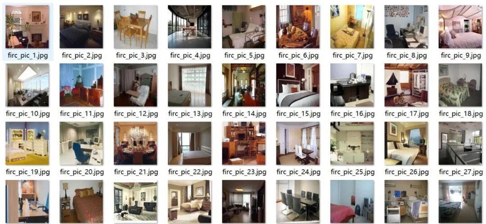
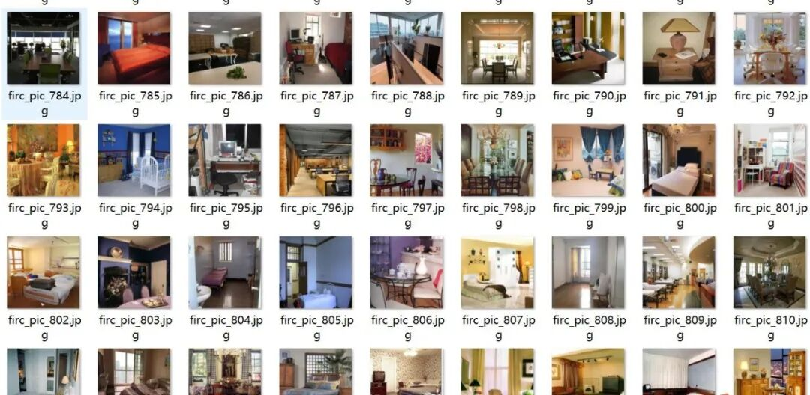
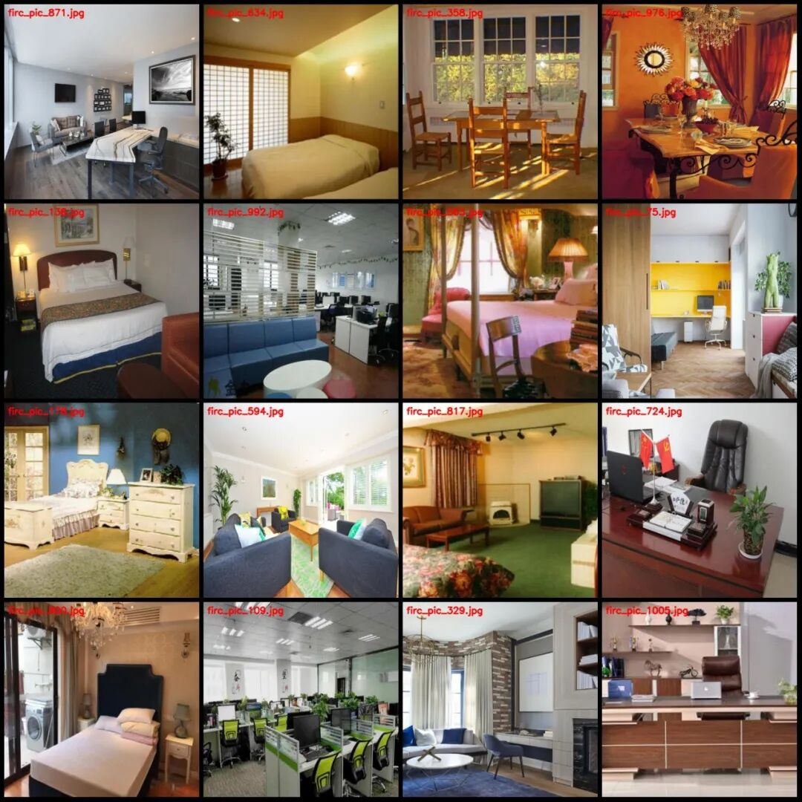
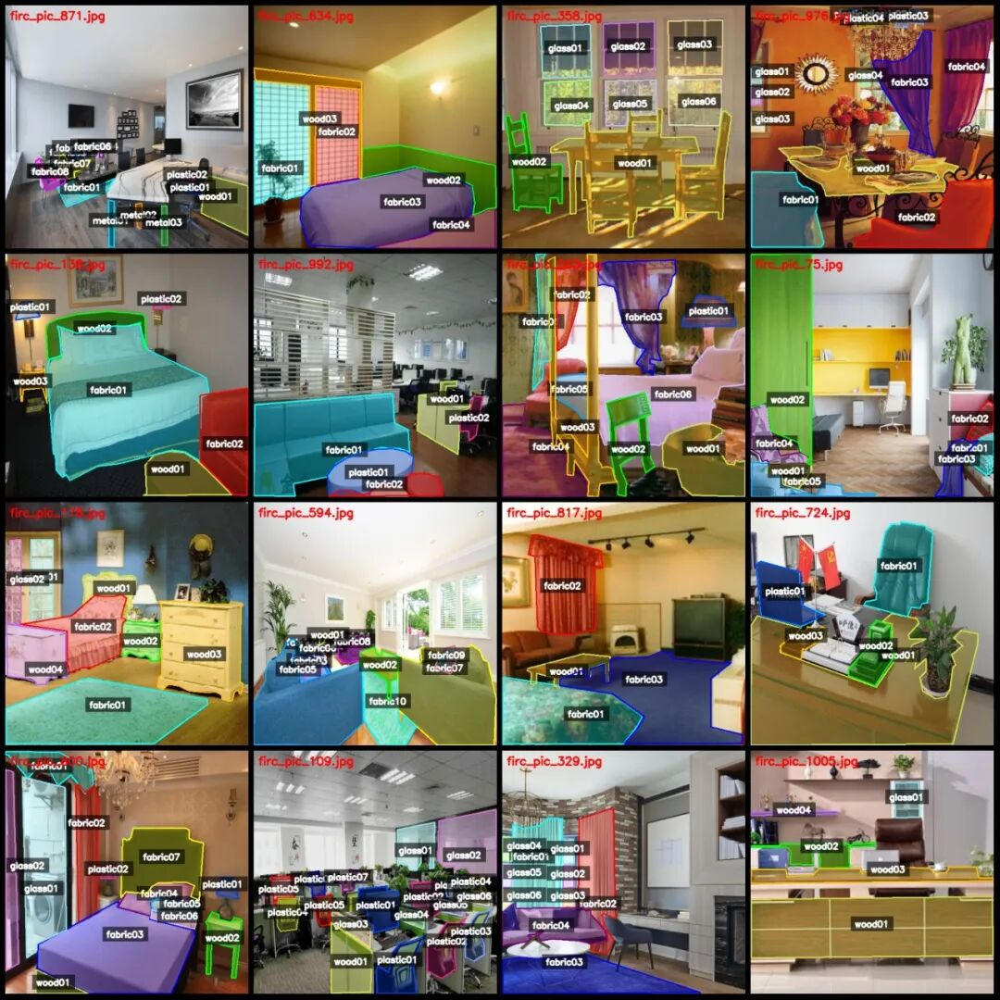
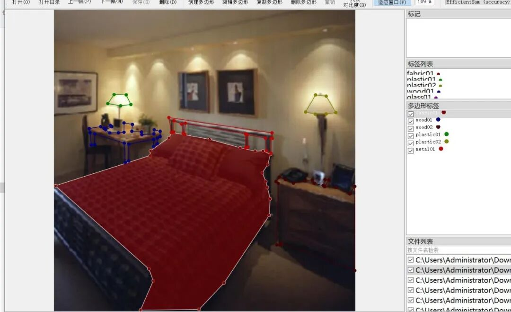
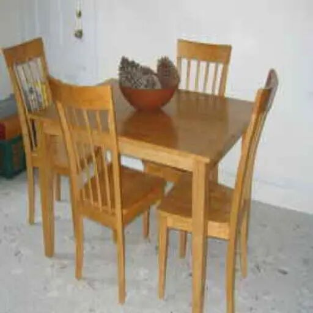
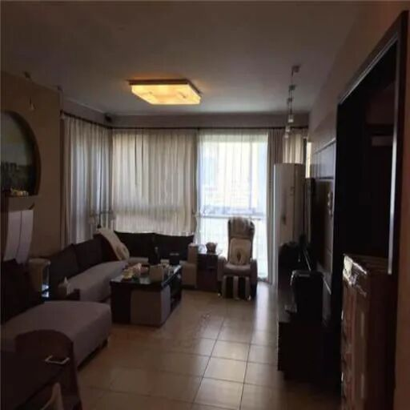

# Indoor Flammable Material Identification and Assessment of Flammability - Indoor Flammability Degree Identification Segmented Dataset in LabelMe format with 10,15 categories.

Dataset format: labelme format (without mask files, only including jpg images and corresponding json files)

Number of images (number of jpg files): 1015

Number of annotations (number of json files): 1015

Labeling category count: 85

The categories are: ["fabric01", "fabric02", "fabric03", "fabric04", "fabric05", "fabric06", "fabric07", "fabric08", "fabric09", "fabric10", "fabric11", "fabric12", "fabric13", "fabric14", "fabric15", "fabric16", "fabric17", "fabric18", "glass01", "glass02", "glass03", "glass04", "glass05", "glass06", "glass07", "glass08", "glass09", "glass10", "glass11", "glass12", "glass13", "glass14", "glass15", "glass16", "glass17", "glass18", "glass19", "metal01", "metal02", "metal03", "metal04", "metal05", "metal06", "metal07", "metal08", "metal09", "metal10", "metal11", "metal12", "plastic01", "plastic02", "plastic03", "plastic04", "plastic05", "plastic06", "plastic07", "plastic08", "plastic09", "plastic10", "plastic11", "plastic12", "plastic13", "plastic14", "plastic15", "po", "wood01", "wood02", "wood03", "wood04", "wood05", "wood06", "wood07", "wood08", "wood09", "wood10", "wood11", "wood12", "wood13", "wood14", "wood15", "wood16", "wood17", "wood18", "wood19", "wood20"]

Number of boxes and the number of images occupied by each category:

Fabric01 frame count = 879, occupying image count = 851

fabric02 frame count = 697, occupy image count = 685

fabric03 frame count = 493, occupy image count = 484

fabric04 frame count = 348, occupy image count = 343

fabric05 frame count = 231, occupy image count = 230

fabric06 frame count = 156, occupy image count = 155

fabric07 frame count = 108, occupy image count = 108

Fabric08 frame count = 73, occupying image count = 73

fabric09 frame count = 51, occupy image count = 51

Fabric 10 frame count = 48, occupying image count = 47

Fabric 11 frame count = 33, occupying image count = 33

Fabric 12 frame count = 21, occupying image count = 21

Fabric 13 frame count = 20, occupying image count = 20

Fabric14 frame count = 9, occupying image count = 9

Fabric 15 frame count = 6, occupy image count = 6

Fabric 16 frame count = 3, occupying image count = 3

Fabric17 frame count = 3, occupy image count = 3

fabric18 frame count = 1, occupy image count = 1

glass01 frame count = 562, occupying image count = 559

glass02 frame count = 422, occupying picture count = 420

glass03 frame count = 264, occupying image count = 264

glass04 frame count = 179, occupying image count = 179

glass05 frame count = 118, occupy image count = 118

glass06 frame count = 71, occupying image count = 71

glass07 frame count = 44, occupy image count = 44

glass08 frame count = 35, occupy image count = 35

glass09 frame count = 22, occupy image count = 22

glass10 frame count = 18, occupy image count = 18

glass11 frame count = 13, occupy image count = 13

glass12 frame count = 10, occupy image count = 10

glass13 frame count = 8, occupy image count = 8

glass14 frame count = 6, occupy image count = 6

glass15 frame count = 3, occupy image count = 3

glass16 frame count = 3, occupy image count = 3

glass17 frame count = 3, occupy image count = 3

glass18 frame count = 2, occupy image count = 2

glass19 frame count = 1, occupy image count = 1

Metal01 frame count = 264, occupying image count = 261

Metal02 frame count = 137, occupying image count = 134

Metal03 frame count = 63, occupying image count = 63

Metal04 frame count = 34, occupying image count = 34

Metal05 frame count = 23, occupying image count = 23

Metal06 frame count = 13, occupying image count = 13

metal07 frame count = 5, occupy image count = 5

Metal08 frame count = 5, occupying image count = 5

Metal09 frame count = 4, occupying image count = 4

Metal10 frame count = 4, occupying image count = 4

Metal11 frame count = 3, occupying image count = 3

Metal12 frame count = 1, occupying image count = 1

plastic01 frame count = 553, occupying image count = 541

plastic02 frame count = 260, occupying image count = 257

plastic03 frame count = 113, occupying image count = 110

plastic04 frame count = 62, occupying picture count = 59

plastic05 frame count = 36, occupying picture count = 35

plastic06 frame count = 21, occupying image count = 21

plastic07 frame count = 9, occupy image count = 9

plastic08 frame count = 6, occupy image count = 6

plastic09 frame count = 6, occupy image count = 6

Plastic 10 frame count = 2, occupy image count = 2

Plastic 11 frame count = 3, occupying picture count = 3

Plastic 12 frame count = 2, occupy image count = 2

plastic13 frame count = 2, occupy image count = 2

Plastic 14 frame count = 2, occupying image count = 2

plastic15 frame count = 1, occupy picture count = 1

Number of PO boxes = 1, Number of images occupied = 1

Wood01 frame count = 914, occupying picture count = 898

wood02 frame count = 697, occupying image count = 686

wood03 frame count = 458, occupy image count = 458

wood04 frame count = 273, occupy image count = 271

wood05 frame count = 161, occupy image count = 161

wood06 frame count = 99, occupy image count = 99

wood07 frame count = 69, occupy image count = 69

wood08 frame count = 49, occupy image count = 49

wood09 frame count = 30, occupy image count = 30

Wood10 frame count = 20, occupy image count = 20

Wood11 frame count = 15, occupying image count = 15

Wood12 frame count = 12, occupying image count = 12

Wood13 frame count = 10, occupy image count = 10

Wood14 frame count = 4, occupy image count = 4

Wood15 frame count = 4, occupy image count = 4

Wood16 frame count = 3, occupy image count = 3

Wood17 frame count = 4, occupy image count = 4

Wood18 frame count = 3, occupying picture count = 3

Wood19 frame count = 3, occupy image count = 3

wood20 frame count = 1, occupy image count = 1

Total frame count: 9428

Using labeling tool: labelme=5.5.0

Image resolution: 512x512

Annotation rules: Draw polygons around the categories.

Important Notice: The dataset can be opened and edited using LabelMe. For JSON datasets, they need to be converted into mask or YOLOF format or COCO format for semantic segmentation or instance segmentation. For indoor scenes, a dataset of flammable objects is constructed based on combustion characteristics, classifying targets into three categories: very flammable (clothing, bedding), flammable (wood, plastic), and non-flammable (glass). Completing the semantic segmentation task based on this dataset can effectively measure the risk level of flammable objects in indoor scenarios.

Special : This dataset does not guarantee the accuracy of the trained models or weight files.

Image Preview:

Annotation example:

Original image (pick 16 randomly):

Annotation:

LabelMe editing example:

Single image:

## Payment

Here is a pay link on Stripe ( https://buy.stripe.com/3cs8yP7sY87d0vu9AB ). Please contact me lonlonago@foxmail.com after funding $89, and I will send you a complete data files , thank you!

